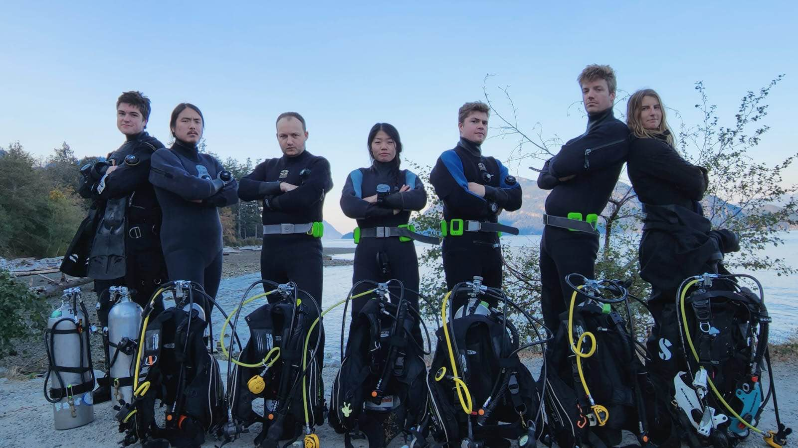
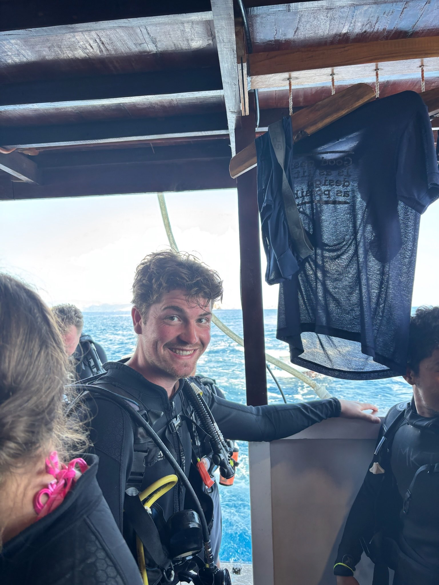
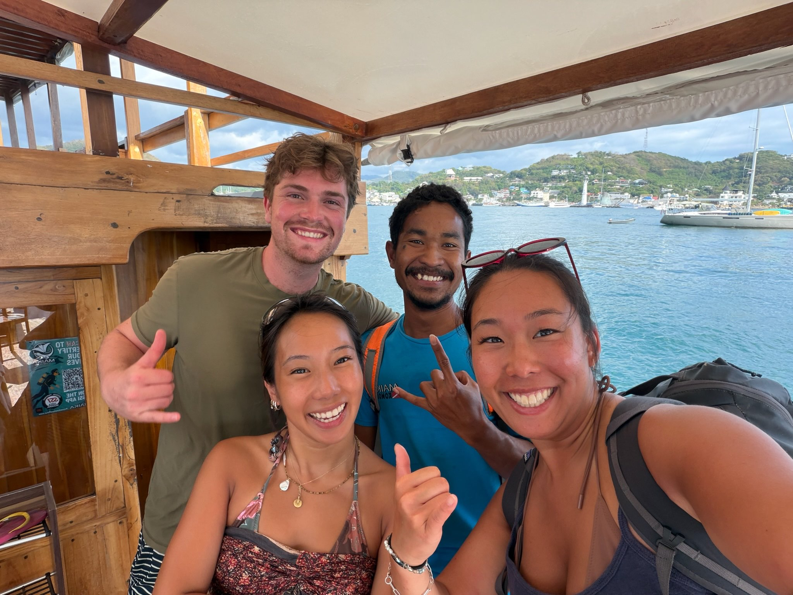
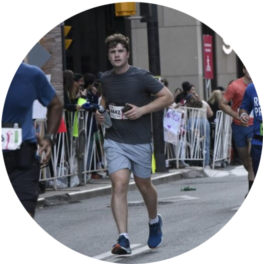
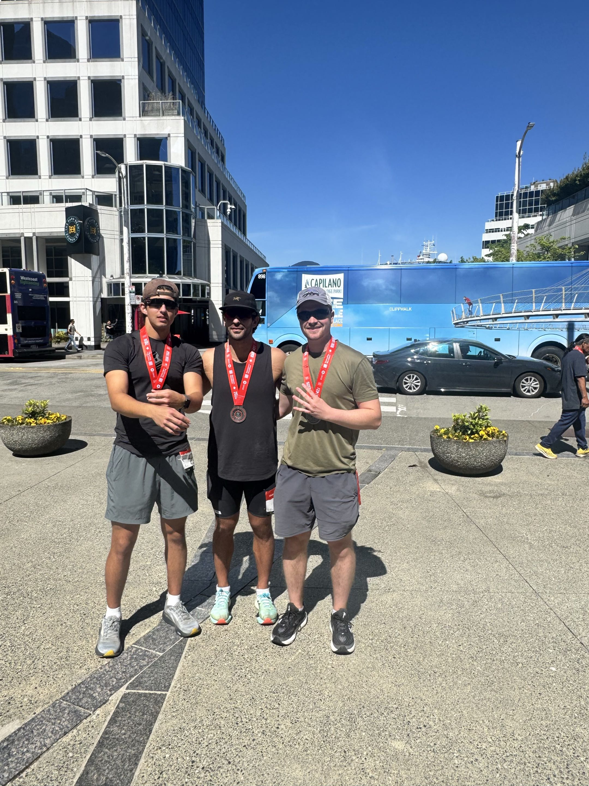
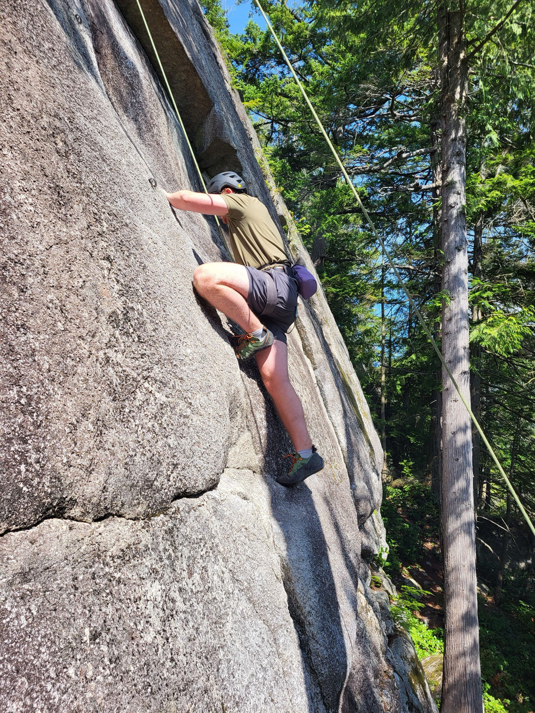
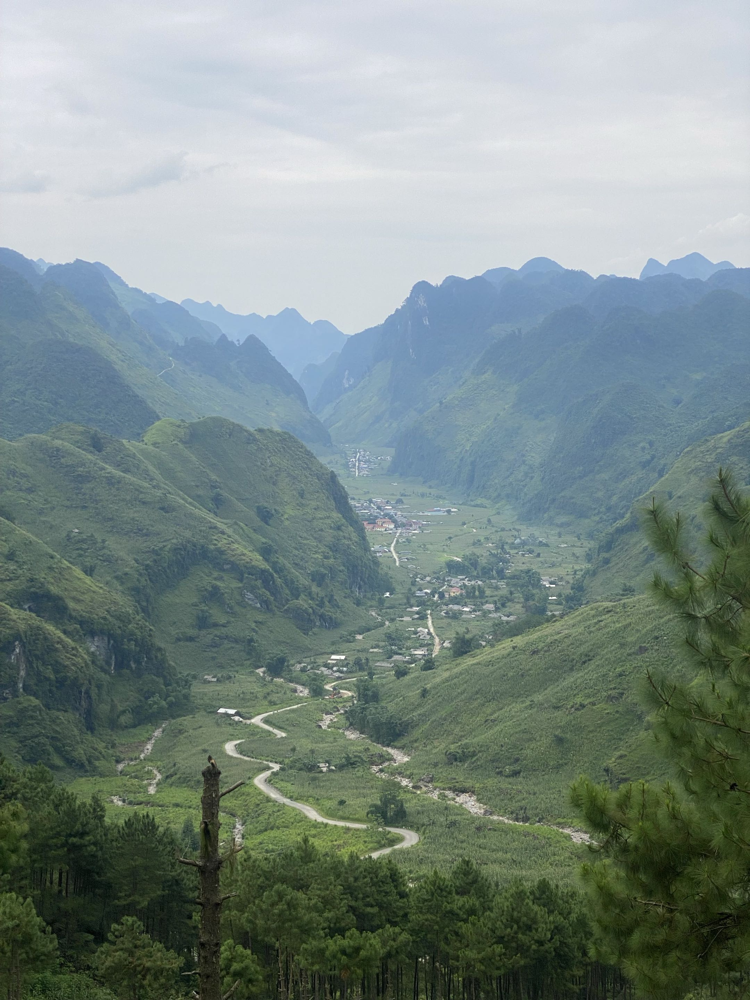
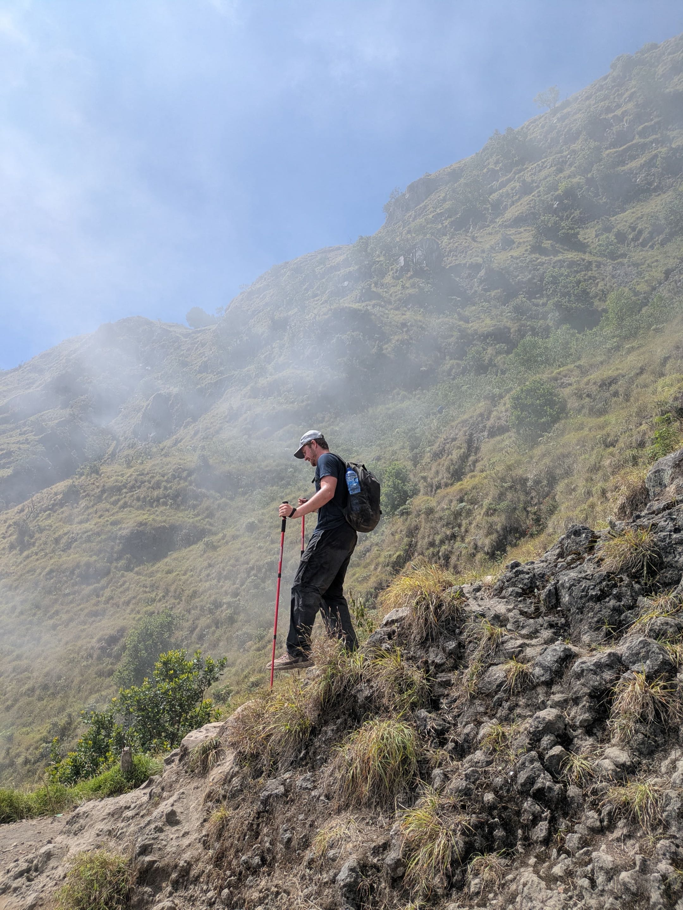

I am a person with many interests. During my time in Vancouver for university, I took advantage of being next to the ocean and got my scuba diving certification, which I've taken with me to other parts of the world and has given another dimension to traveling.
 

Some friends and I in our gear after getting our PADI Advanced Open Water diving certification.

Me in my wetsuit post-scuba diving in the Komodo Islands in Indonesia!

Me and friends with our diving instructor in Indonesia!

 

After playing soccer my entire life at a competitive level, and then stopping during university, I found myself lacking goals in the area of fitness and physical activity. I got roped into running the 2024 Toronto Waterfront Marathon with some friends and started to enjoy running.

I ran the 2024 Toronto Waterfront Marathon, in the middle of the school semester. It was a huge challenge to train 
during the school semester, but it ended up being immensely rewarding to finish the full marathon for the first time.
After this experience, I decided I would take training more seriously and come back and complete a marathon with a goal time of under 4 hours.

In May 2026, a year and a half after my first marathon, I ran the Vancouver BMO Marathon with a time of 3:57:36, achieving my goal time.

 

And of course living in Vancouver I inevitably found myself climbing rocks.

Me climbing a slippery slab in Squamish, BC.

 

After graduating university, I had the privilege of traveling to Southeast Asia with one of my best friends.

Duong Thuong, translated to 'Valley Road' was a region and village in the northern Ha Giang province in Vietnam. I rode 
on the back of a motorcycle through the province for a few days and got spoiled by the views, and got to 
experience an amazing and unique culture.

While in Indonesia, I climbed the highest mountain on Lombok. Mount Rinjani was a 3-day hike, including a 
2am wake-up for a sunrise summit on the second day. I feel lucky to have experienced this.

 