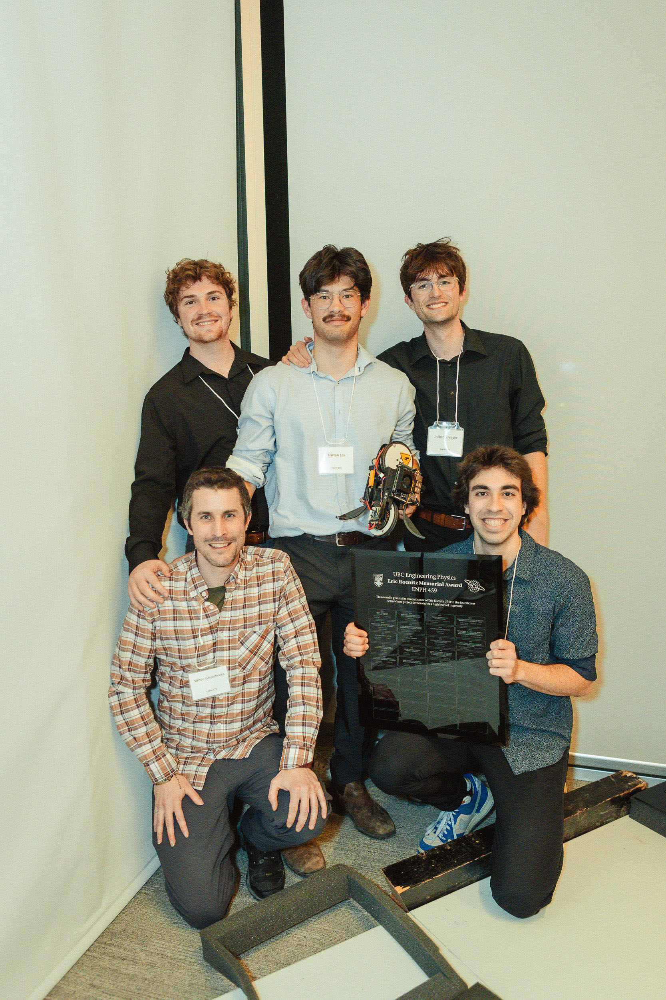
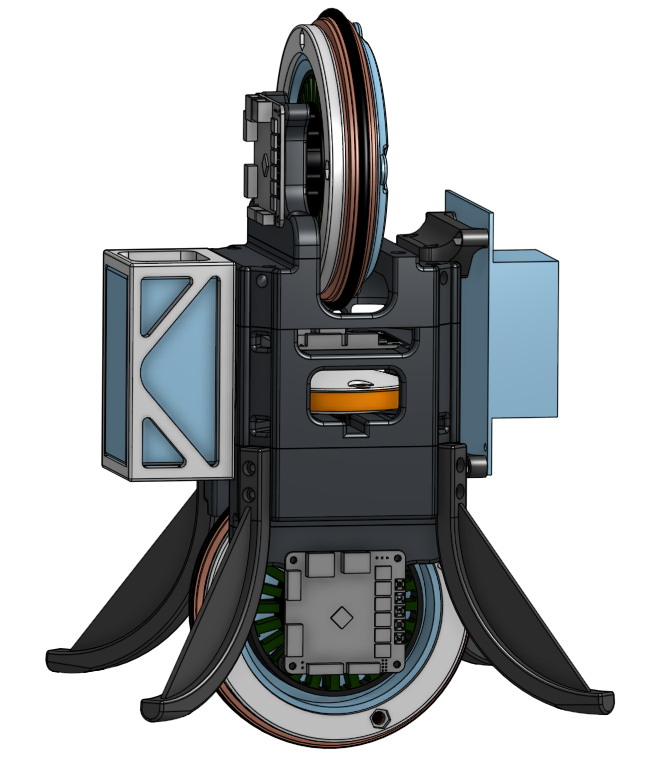
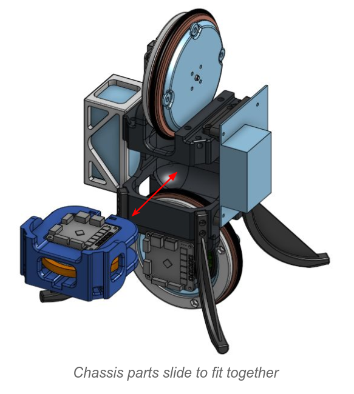
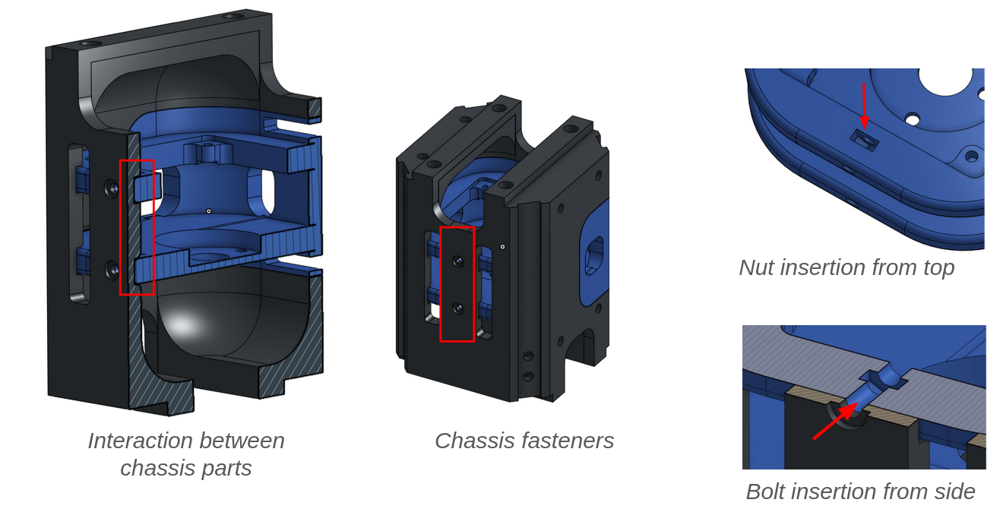

# Capstone: Reaction-Wheel Inverted Pendulum
*Jan. 2024 - April 2025* 

  

We won the Eric Roenitz Memorial Award, granted to a Capstone project that demonstrates a high level of ingenuity in design and execution.

The focus of our Engineering Physics Capstone project was to survey and compare controls strategies for robots with unstable dynamics. We found that 
despite the boom in the AI industry, there was little research on this specific topic. This allowed us to do something novel by documenting our findings.

We compared the performance of more classical controls models including PID, Linear-Quadratic Regulator (LQR), and Model-Predictive Control (MPC). These were compared 
with the performance of many variations of a neural-network-based controller, all trained using Reinforcement Learning with different parameters.

## What makes this problem interesting? 

One of the main challenges of this project was characterizing the dynamics of our robot. Our robot had a motor oriented in each of the three axes. This brings about highly 
complex dynamics equations due to phenomena such as gyroscopic procession, 
caused by the conservation of angular momentum and the coupling between the axes under rotation of the robot.

The classical controls methods required the linearization of the equations of motion of the robot. This cancelled out 
the higher-order effects of the dynamics, but also limited the accuracy of the equations in different positions. 

The approximation of the equations was centered at the upright position of the robot, with zero wheel speed in 
any of the three motors. This was our 'zero state' and meant that once the robot was tipped over in any direction, 
or had any wheel speed, the dynamics model was less accurate. Thus, the control strategy is to keep the robot as close to upright 
as possible, and to keep the wheel speeds minimal.

## The Sim2Real Gap

Keeping wheel speeds minimal is not as straightforward as it sounds. Imagine the robot tilts to the left
and therefore requires motor torque to nudge it back into the upright position. Once it reaches the upright position, 
the equilibrium state is for there to be zero torque applied to the robot, meaning zero acceleration **or deceleration** of the wheels. 
Thus, whatever speed the motor is spinning at the upright position must be maintained. This is one of the aspects
we had to consider when going from a theoretical control model to a real-life robot with physical 
limitations such as maximum wheel speed, maximum torque, and inaccuracies in physical design, center of mass,
et cetera. This is generally referred to as the **Sim2Real** gap in the machine learning field but applies 
to non-machine-learning controls models alike.

## Chassis Design

One major personal contribution to the project was that I took the first iteration of the chassis, done by one of my teammates, 
and created the next and final design with modularity as the main principle driving the design. 

 

Modularity allowed us to rapidly assemble and disassemble our robot whenever we needed to access components that were unreachable. 
This was key for this project as we were constantly tweaking the mass distribution on the wheels, and needed to access the motor driver board
in the center wheel often. 

The way I built modularity into the design was to first opt for a sliding mechanism to fit the parts of the chassis together, as opposed to stacking the top, middle,
and bottom portions of the chassis, which is what was in the previous iteration. 

Another focus of the design was to reduce the angular moment of inertia as much as possible of the entire robot, which 
generally meant keeping the mass low. One way this was achieved was by reducing the number
of required fasteners by orienting them such that the highest loads were transferred through the chassis
and not through the fasteners.

## LQR and MPC controller development

The gains for the LQR controller are calculated using an optimization algorithm, which takes a sort of cost function as its input. Therefore, the controller is only good as your cost function is, as for any given cost function, the LQR optimization will create an optimal controller to minimize the given function. 

In our case, our cost function primarily uses the angles of the robot, measured from upright, so that the optimized 
controller tries to minimize the angle of the robot, keeping 
it balanced. Additionally, the physics of electric motors 
create some challenges: All electric motors have a maximum 
speed, at which torque cannot be further applied in the direction 
of rotation. Therefore, we need to penalize high motor speeds 
to make sure the controller never gets itself to a point where 
it can no longer apply a torque, otherwise it may be unable 
to self-right. This is a tricky problem to solve non-naively, and 
went far beyond the classical control theory we take in our 
undergraduate studies, thus making it an exciting challenge
to solve. In the end, the theoretical LQR model needed some fine-tuning due to inaccuracies
in the Sim2Real gap as well as physical limitations that required adjusting the behavior
of the algorithm, such as the zero-wheel-speed issue mentioned in the Sim2Real section.

## Summary 

The aspect of this project that was the most rewarding was being able 
to combine knowledge we had learnt throughout our degree from multiple disciplines of 
engineering including mechanical design courses, electrical analysis, software 
design principles, control theory, and machine learning. It was a culmination of a lot of hard work throughout 
our degree and resulted in a multi-disciplinary project that had many interesting aspects interacting with 
each other.