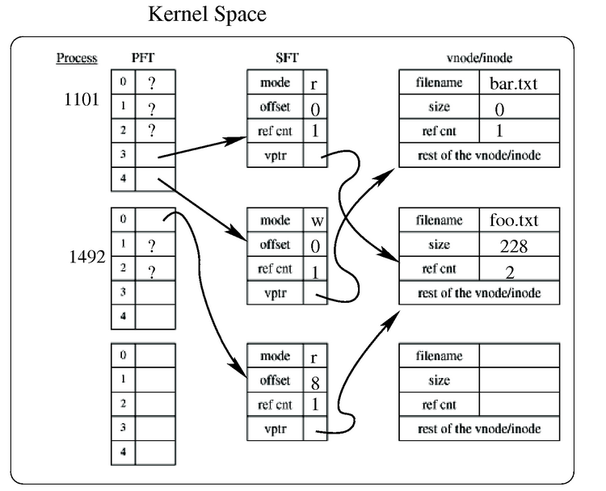
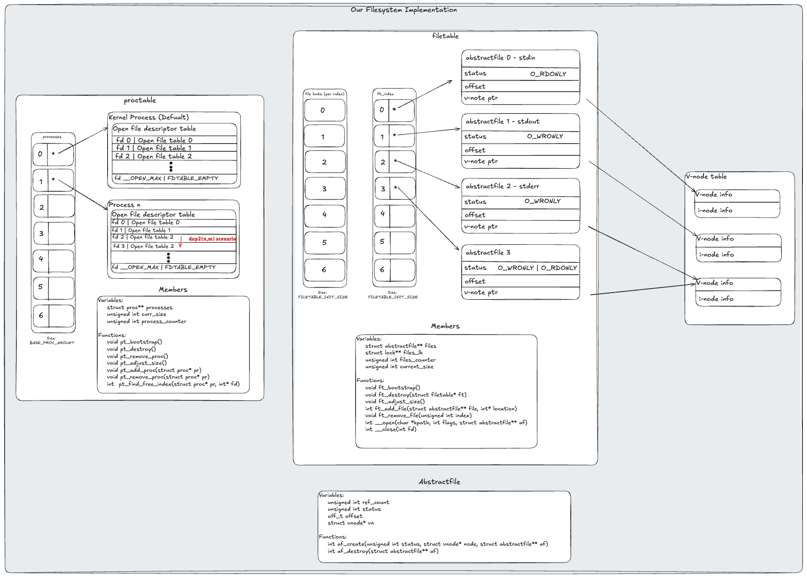
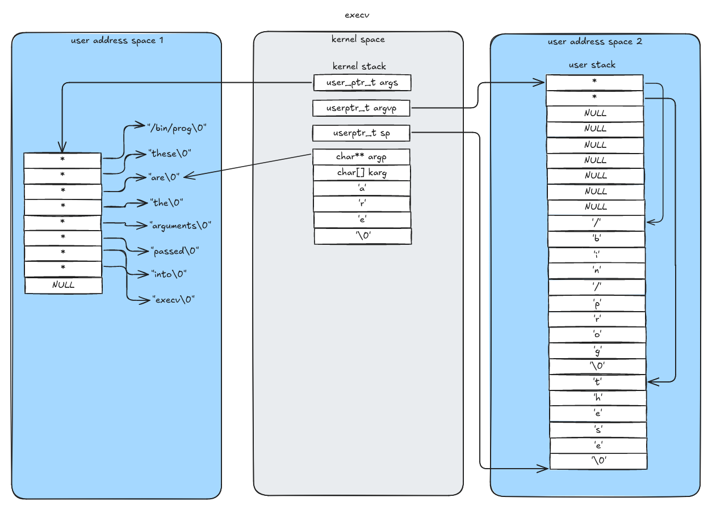
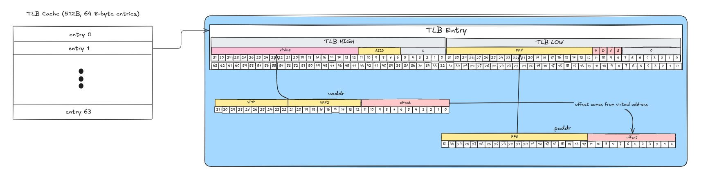

*Sept. 2024 - Dec. 2024* 

I took CPEN 331, the Operating Systems course at UBC, in which I built the foundational components of an operating system using the educational OS/161 from Harvard's CS161 course. The main components I developed were 'synchronization primitive' types for multi-threaded programming, a custom-designed 'filetable' system, which manages multi-threaded access to a shared file system between processes, a custom process management architecture that implements the `fork()`, `execv()`, and `waitpid()` system calls, among others, allowing duplicated processes, new process creation, and child process management. Finally, I developed a custom virtual memory system which manages RAM, disk memory, and swap space.

## Synchronization

I used synchronization primitives (namely spinlocks) to implement higher-level primitives to aid in writing concurrent multi-threaded code for a multi-core machine, including locks, semaphores, and condition variables.

The spinlock uses the atomic assembly instruction `tas`, test-and-set, which allows no interleaving of instructions from other processes. Then, the higher-level primitives including locks and semaphores are built upon the spinlock implementation to create a level of abstraction of synchronization above the assembly code, which further supports the synchronized implementation of the higher-level operating system components.

These synchronization tools were then validated to work with hundreds of threads, which manipulated shared data safely.

## Syscalls - File Management

I implemented the system calls that linux uses to modify files: `open()`, `close()`, `read()`, `write()`, and `lseek()`. These system calls required the implementation of a system-wide data structure that tracks open and closed files, and manages the shared access to them between processes. We followed the standard Unix file system structure with a few small modifications.

  
*Standard Unix file table*

*Our version of the Unix file table, using extra data structures to support dup() features elegantly*

## Syscalls - process creation

I implemented the system calls `fork()` and `execv()`, which are used to create new processes in the kernel. 

### `fork()`: Spawn an identical copy of the current running process

Required the current process' address space (the sections of memory that it, alone, has access to) to be copied to the new process in a way that left no duplicate pointers. The way we did this was by copying all of the contents of the parent process' physical pages onto a set of newly allocated physical pages, and adjusting the address space' pointers such that any translated virtual addresses in the new (child) process would point to these newly allocated copies

### `execv()`: Replace the current running program with a new one.

It required careful management of kernel memory, while being able to copy up to 64KB of memory from the old address space to the new. We decided on a chunking strategy, where we allocate space on the new user 
stack, and copy a single kilobyte of memory over at a time. This strategy allows the kernel to stay lean, and reduce the amount of pages required by the kernel on a standard machine, which is a large benefit
in real-world kernel design. 

*Image: Midway through copying arguments from old address space, to new address space, using the kernel stack as a buffer for chunks of strings*

## Virtual memory system

For the final assignment of this computer engineering course, I designed and implemented a virtual memory system for OS161 to replace the existing DUMBVM, which had no page-tracking and page eviction program. The project involved several key tasks, including servicing TLB faults, implementing paging to enable memory swapping between RAM and disk, and developing a page eviction algorithm, along with implementing swap-space to allow the virtualization of memory, letting the computer allocate more memory than exists in RAM at one time. 

I also added support for the `sbrk()` system call, enabling dynamic heap memory allocation, and implemented functionality to properly handle memory management during process forking. Additionally, I incorporated a more robust TLB eviction strategy to prevent kernel crashes due to TLB overflow. By replacing DUMBVM with a more comprehensive system, I allowed OS161 to manage multiple processes efficiently, and evict old processes' memory, providing each with the virtualization of an expansive virtual memory space, even with limited physical (RAM) memory. This project required integration with the MIPS architecture, memory management units, and synchronization protocols, all of which were critical for debugging the system and ensuring proper operation.